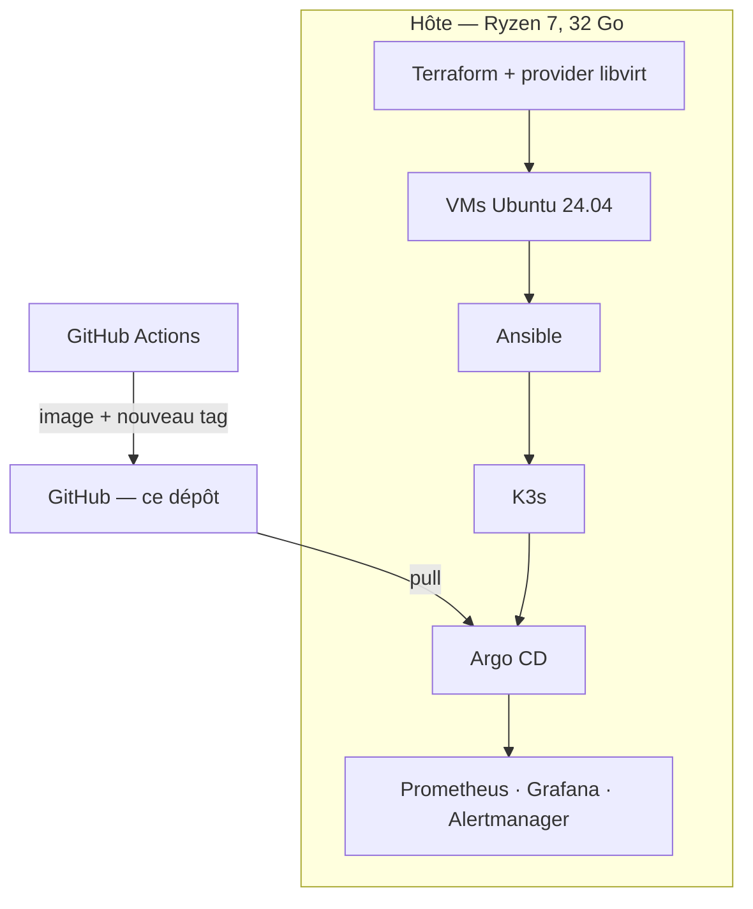

# GitOps Lab

Un cluster Kubernetes local, **reconstruit depuis Git** : une modification poussée sur
`main` arrive dans le cluster sans aucune commande `kubectl apply`.

Projet personnel d'apprentissage et de démonstration. Ce n'est **pas** un cluster de
production ; les limites sont assumées et documentées.

## Architecture cible

## Ce que ce lab démontre

| Compétence | Preuve concrète |
|---|---|
| GitOps | `git push` → pod mis à jour, sans `kubectl apply` |
| Infrastructure as Code | `make up` reconstruit le cluster depuis zéro |
| Kubernetes | K3s, manifests, probes, Ingress |
| Observabilité | dashboards versionnés, alerte qui se déclenche vraiment |
| Gestion d'incident | 4 scénarios de panne reproductibles |

## État du projet

| Session | Périmètre | État |
|---|---|---|
| 1 | Boucle GitOps : K3s → Argo CD → application | 🚧 en cours |
| 2 | Terraform + Ansible, cluster 3 nœuds | ⏳ à venir |
| 3 | Observabilité, alerting, scénarios de panne | ⏳ à venir |

## Ce que ce lab n'est pas

- **Pas hautement disponible** : un seul control-plane, stockage local.
- **Pas de cloud payant**, pas de cluster managé, pas de compte obligatoire.
- **Pas une démonstration de volume** : chaque outil présent répond à un problème
  rencontré, pas à une envie de l'ajouter.

## Décisions d'architecture

Les choix structurants sont documentés dans [`docs/adr/`](docs/adr/), au format
*Contexte / Décision / Conséquences*.

## Licence

MIT — voir [LICENSE](LICENSE).
